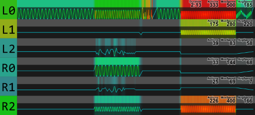
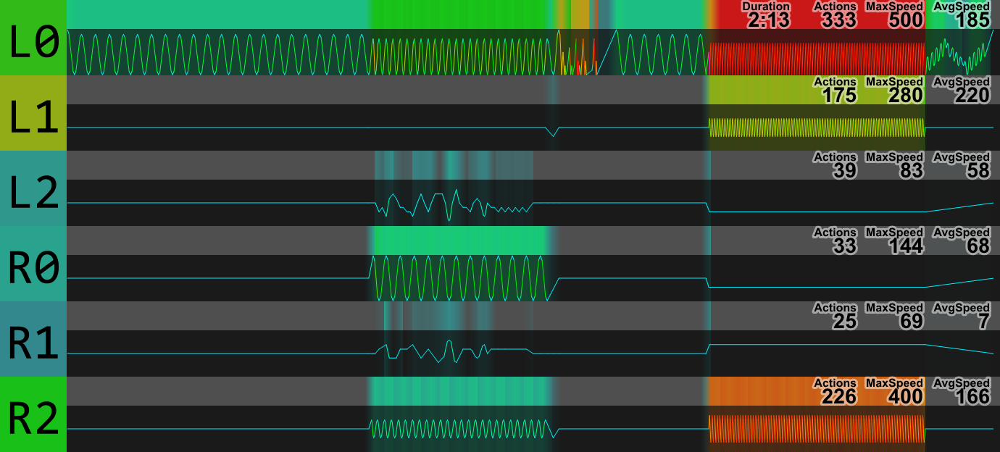
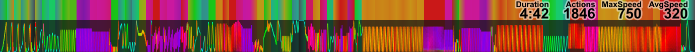
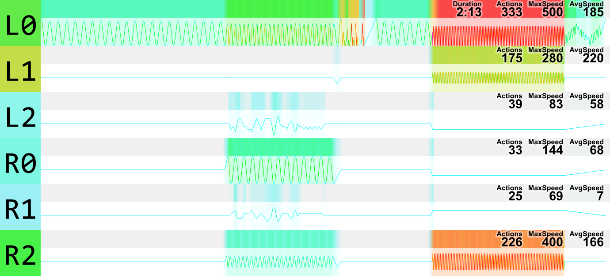

# Funscript 缩略图（Windows 资源管理器）

[English](README.md) · **简体中文**

一个 Windows Shell 缩略图处理程序（`IThumbnailProvider`），为 `.funscript` 文件生成 **eroscripts 风格热力图**，直接显示在资源管理器的**详细信息窗格顶部图标处**、**大图标 / 超大图标视图**和**文件提示**里。不需要额外程序，也不依赖预览窗格。



> **[完整效果总览 →](https://kotone-hikaru.github.io/FunscriptThumbnail/)** —— 全部视图、深浅两套底色、图标集，以及配色校准过程。

---

## 为什么做这个

`.funscript` 就是一段 JSON，没有内嵌缩略图，所以资源管理器只给一个空白通用图标。现有方案多是**预览处理程序**（preview handler），只能画在**预览窗格**——详细信息窗格的图标框、图标视图和提示依旧是空的。

本项目改成**缩略图处理程序**，热力图就出现在你翻文件夹时真正会看的位置。渲染部分是对 [eroscripts](https://eroscripts.com) 渲染器的完整移植，包括配色、统计和布局。

---

## 特性

| | |
|---|---|
| **eroscripts 视觉风格** | 相同的速度→颜色 OKLCH 映射、相同的渐变背景、相同的 `Duration / Actions / Max Speed / Avg Speed` 读数。 |
| **多轴脚本** | 支持 v1.0 `axes` 与 v2.x `channels`，每个轴一行堆叠（`L0 L1 L2 R0 R1 R2 …`），每行独立统计，与 ES 站点版式一致。 |
| **默认深色底** | 背景逐像素对着 eroscripts 深色模式校准（页面 `#1A1A1A`、统计条 `79,79,79`、图形区 `26,26,26`）。 |
| **真正的系统集成** | 机器级注册，**设置 → 应用**里一条卸载项，可直接从那卸载。 |
| **崩溃隔离** | 托管在 Windows 隔离缩略图宿主 `dllhost.exe` 里，不在 `explorer.exe` 内。畸形脚本最多崩 dllhost，不会带走你的桌面。 |
| **容错解析** | 处理实盘中常见的坏数据：`metadata.duration` 是浮点、POS 是字符串、动作未排序/重复、负时间戳、缺 metadata。 |
| **零运行时依赖** | 纯 .NET Framework 4.8 + GDI+，运行期无 NuGet 依赖。 |

### 多轴



### 单轴



另有浅色底版本（见[命令行](#命令行工具)）：



---

## 安装

1. 下载 **[FunscriptThumbnail.zip](https://github.com/Kotone-Hikaru/FunscriptThumbnail/releases/latest)**（或直接用仓库里的 `dist/`），解压到任意位置。
2. **双击 `install.cmd`** —— 它会自己弹 UAC 请求管理员权限。
3. 完成。打开一个含 `.funscript` 的文件夹即可。

卸载**不需要**再找 cmd 文件：**设置 → 应用 → 安装的应用 → “Funscript 缩略图” → 卸载**。

### 环境要求

| | |
|---|---|
| 系统 | Windows 10（1903 及以上）/ Windows 11，**64 位** |
| 运行时 | **.NET Framework 4.8** —— Win10 1903+ 与 Win11 自带，无需安装 |
| 权限 | 仅安装/卸载时需要管理员 |

`install.cmd` 会先校验 .NET 版本和文件是否齐全，缺什么就明确报什么，不会出现“双击了没反应”。

### 安装会改动什么

- `C:\ProgramData\FunscriptThumbnail\bin-<时间戳>\` —— DLL、工具、图标，以及一份自带的卸载副本
- `HKLM\SOFTWARE\Classes\CLSID\{6E3A2F41-6B1D-4C3E-9F27-2B8D5A7C1E90}` —— COM 类
- `HKLM\SOFTWARE\Classes\.funscript\ShellEx\{e357fccd-…}` 以及 `SystemFileAssociations` 下的同名键 —— 缩略图挂接点
- `HKLM\SOFTWARE\Microsoft\Windows\CurrentVersion\Uninstall\FunscriptThumbnail` —— 「设置 → 应用」里的条目
- `HKLM\SOFTWARE\Classes\.funscript` 的 `TypeOverlay` / `Treatment` —— 去掉快捷键小箭头覆盖和缩略图外框（仅在你原本没有设置时写入）

**不会**改动你的 `.funscript` 文件关联或默认打开方式。

---

## 从源码构建

```
git clone https://github.com/Kotone-Hikaru/FunscriptThumbnail.git
cd FunscriptThumbnail
build.cmd
```

`build.cmd` 会找到 .NET SDK、以 Release 构建 `FunscriptThumbnail.sln`，并把产物复制进 `dist\`。需要 **.NET SDK**（任何支持 `net48` 的版本，测试用 10.0.x）——只有 .NET Framework 运行时不足以编译。

也可以用 Visual Studio 2019/2022 直接打开 `FunscriptThumbnail.sln`。

### 目录结构

```
src/FunscriptThumbnail/     COM 缩略图提供程序（资源管理器实际加载的 DLL）
  ThumbnailProvider.cs        IThumbnailProvider + IInitializeWithStream
  HeatmapRenderer.cs          eroscripts SVG 渲染器的 GDI+ 移植
  Stats.cs                    Duration / Actions / Max Speed / Avg Speed
  SpeedColor.cs               速度 → OKLCH → sRGB，与站点逐位一致
  Funscript.cs                容错解析 + 轴向归一化
  MiniJson.cs                 零依赖 JSON 读取器（带深度上限）
  Diag.cs                     按需开启的跟踪日志
src/FunscriptThumbTool/     安装 / 卸载 / 诊断命令行
dist/                       预编译、可直接安装的产物
docs/                       截图与可视化总览页
```

---

## 命令行工具

`FunscriptThumbTool.exe` 同时是安装器和诊断工具：

```
status                                   注册状态、DLL 路径、驻留方式
install [--in-process]                   机器级注册（需管理员）
uninstall [--quiet]                      移除注册与文件
render <in.funscript> <out.png> [尺寸]    用与资源管理器完全相同的代码渲染 PNG
shelltest <file> <out.png> [尺寸]        走系统外壳取缩略图
colors                                   打印速度→颜色对照表
```

`render … --light` 输出浅色底版本。`shelltest` 是最诚实的端到端验证——它走 `IShellItemImageFactory`，也就是资源管理器走的那条路径。

---

## 实现要点

1. 资源管理器向 Shell 请求某个 `.funscript` 的缩略图。
2. Shell 从 `HKLM\…\.funscript\ShellEx\{e357fccd-a995-4576-b01f-234630154e96}` 读到我们的 CLSID，在隔离宿主 `dllhost.exe` 里实例化该类。
3. `IInitializeWithStream::Initialize` 收到文件流；提供程序整段读入、识别 UTF-8/UTF-16 BOM、解析 JSON 并归一化动作。
4. `GetThumbnail(cx)` 先按逻辑宽度 690 px 排版（每轴一行 + 统计表头），再等比缩放到最长边等于请求的 `cx`，返回 HBITMAP。
5. Shell 按文件路径把结果缓存进 `thumbcache_*.db`。

如果你要改这份代码，有两个坑值得先知道：

- **必须用 `CompositingQuality.HighSpeed`，不能用 `HighQuality`。** GDI+ 的高质量合成在线性光（伽马校正后）空间做 alpha 混合，会让 20% 不透明度的热力图明显发白。浏览器（因此也包括 eroscripts）是在 sRGB 空间混合的，`HighSpeed` 才与浏览器一致。
- **半透明平面先按浮点合成再绘制。** GDI+ 把 alpha 量化成 8 位，`0.3 × 204 + 0.7 × 26` 会落在 80 而不是 79。先把平面混到背景色上，才能复现站点的精确值。

---

## 支持的输入

| | |
|---|---|
| 格式 | `.funscript`（JSON），单轴与多轴 |
| 多轴 | v1.0 `axes` 数组、v2.x `channels` 映射、`metadata.axes` |
| 轴名映射 | `stroke→L0`、`surge→L1`、`sway→L2`、`twist→R0`、`roll→R1`、`pitch→R2`、`suck→A1` |
| 章节 | `metadata.chapters`（存在时绘制章节条） |
| 容错 | 浮点 `metadata.duration`、字符串 POS、乱序或重复动作、负时间 |

---

## 已知限制

- **单轴脚本在方形图标框里就是一条细线。** 版式是 690 × 52（eroscripts 原始比例），而 Windows 对缩略图是等比缩放、不裁切，所以在 256 × 256 的框里这条只占中间一小条。多轴脚本接近方形，填充得比较饱满。这是对齐站点比例的必然结果。
- 资源管理器**按文件路径**缓存缩略图。安装前看过的文件会一直保留空图标，运行 `dist\clear-cache.cmd` 或把文件复制成新名字即可。
- 本项目是缩略图处理程序，**不是**预览处理程序。如果你还想要预览窗格里的大图，那需要另写一个 `IPreviewHandler`（预览窗格显示的是你当前安装的预览处理程序的输出）。
- 仅支持 Windows 10 1903+ / 11 —— 依赖 `SHCreateItemFromParsingName`、隔离宿主和现代「设置」应用。

---

## 致谢

渲染风格、配色、布局与统计算法移植自 **[Eroscripts/funlib](https://github.com/Eroscripts/funlib)**（`src/rendering/svg.ts`、`src/utils/converter.ts`、`src/utils/manipulations.ts`），MIT 许可。

OKLCH → sRGB 转换遵循 **[colorizr](https://github.com/gilbarbara/colorizr)**，MIT 许可。

在资源管理器里显示 `.funscript` 元数据的想法来自 **[martinAlt335/FunscriptWindowsPreviewExtension](https://github.com/martinAlt335/FunscriptWindowsPreviewExtension)**（一个预览处理程序）。本项目是针对缩略图接口的独立实现，与其不共享代码。

详见 [THIRD_PARTY_NOTICES.txt](dist/THIRD_PARTY_NOTICES.txt)。

## 许可

[MIT](LICENSE)
